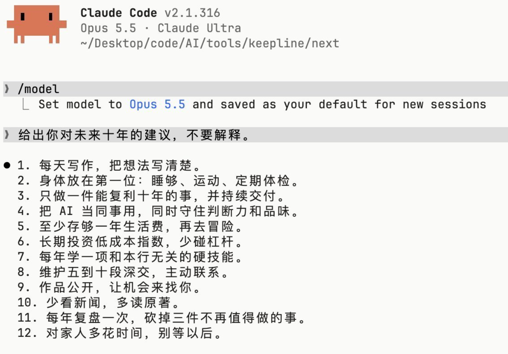

+++
date = '2026-11-03T10:43:52+08:00'
draft = false
title = '多写作，少看新闻'
tags = ['life']
categories = []
summary = '最近遭遇了股票大跌，工作也少了一些，想要坚持写作'
+++

因为股票大跌的原因，看新闻也都是糟糕的消息，所以打算要少看，看了股票也不涨 ...

<!--more-->

## 股票大跌

Intel Google 和 NET，我的三大持仓最近都崩掉了，虽然不是特别担心，目前心态还稳。 但看再多的消息，股价一时半会怕是回不来的，所以也不打算看很多糟心的消息。自动远离 

另外，就是看很多消息后，能看到别人成功，又成功了，好像 AI 在手，天下我有，但我做起来感觉都是困难。 好不容易想出来一条道，发现用户并不买单； 好不容易捣鼓一种方案，发现并没有转化。 当然这的确是做开发中经常遇到的，这是常态。 但是看到别人很容易就成功，不免心生嫉妒， well， 也并不是很嫉妒。 还是要多学习，也不要全信。 

## 少看新闻多写作

今天早上看到下面这幅图：

所以就写下这篇文章。 我的感触是， 非常赞同这些观点，管它是 AI 写的，还是 AI P 的，多半就是 AI 写的，谁没事还人工输出。 

多写作不能让自己发财，但通过我最近和 muse 的互动，至少是有个记录。 比我搭了这个写作的项目，一年多了，才写了两篇文章要好不少。 所以今后真的会开始记录，我可能能写很多。 

## 转型做媒体

昨天写了一篇文章，今早9点自动发了，目前来看，可能不如上一篇火爆（毕竟是讲同一个事情），但依然比早前要好一些。我也不知道这个方向对不对，但我得往这条路上走一走了。  相比媒体，我可能更喜欢 build. 但 build 的前提也是有人买单，如果做出来的东西没有人愿意花钱买，这就不如不做了。 

写文章我可能没那么在行，但有时候也能抓住一两个点。 现在有 AI 加持。写完文章， 视频也就可以做出来了。 但视频的表现实在是太差了。 

慢慢来，step by step.
